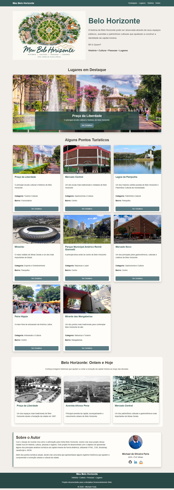
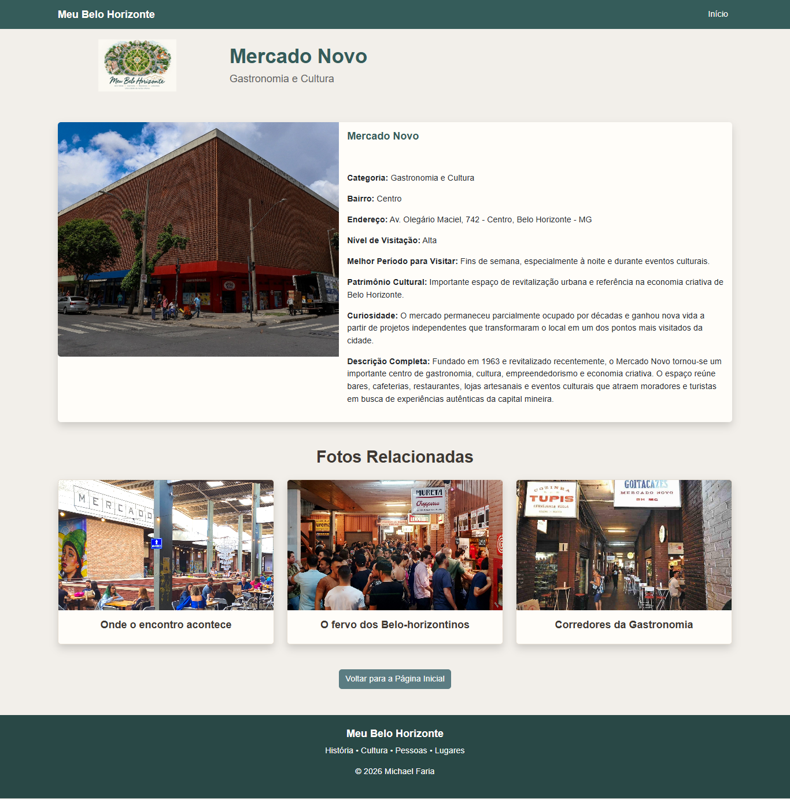
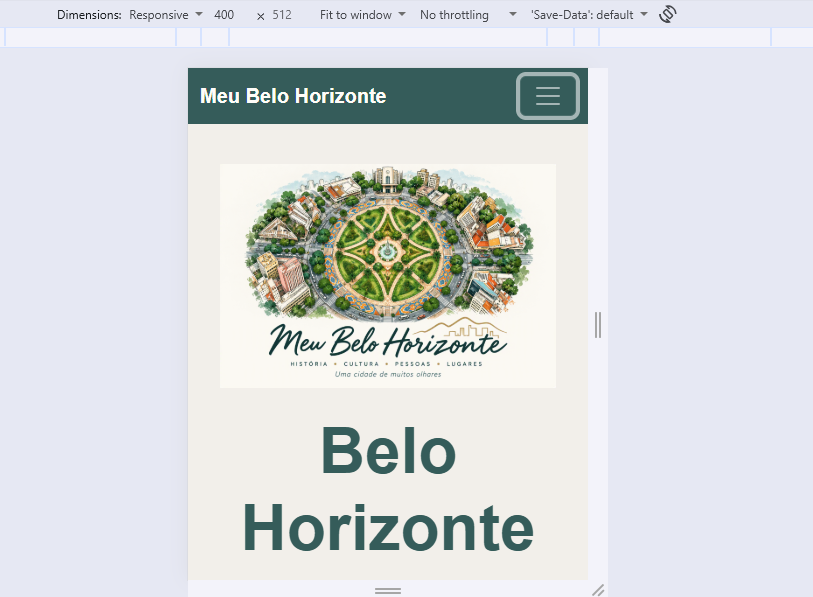
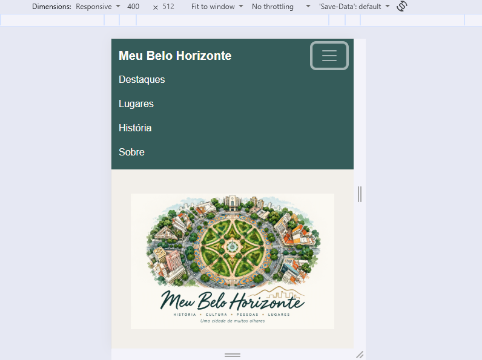
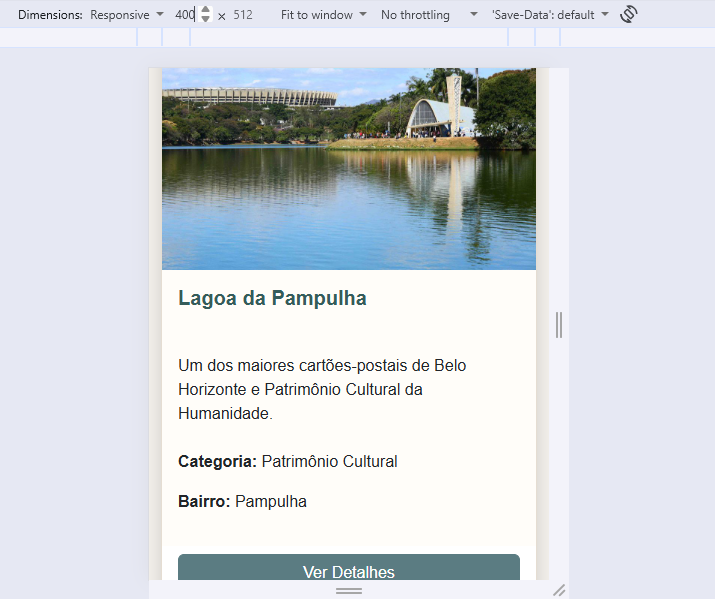
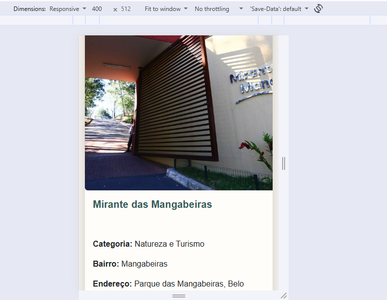

# Meu Belo Horizonte

## Aluno

**Nome:** Michael de Oliveira Faria

**Matrícula:** 931634

**Curso:** Análise e Desenvolvimento de Sistemas

---

## Sobre o Projeto

O projeto "Meu Belo Horizonte" foi desenvolvido para a disciplina de Desenvolvimento Web Front-End e apresenta alguns dos principais pontos turísticos, históricos e culturais da capital mineira.

O sistema utiliza HTML, CSS, Bootstrap e JavaScript para gerar o conteúdo de forma dinâmica a partir de uma estrutura JSON.

As informações são organizadas em:

- Página Principal
  - Logo e apresentação do projeto
  - Carousel com lugares em destaque
  - Cards com os pontos turísticos
  - Seção histórica "Belo Horizonte: Ontem e Hoje"
  - Informações do autor

- Página de Detalhes
  - Informações completas de cada local
  - Fotos associadas
  - Curiosidades
  - Patrimônio cultural
  - Melhor período para visitação
  - Nível de visitação

---

## Observação

A imagem da logo foi gerada pelo Copilot a partir de um prompt compartilhando informações sobre o trabalho e uma imagem da Praça Raul Soares para auxiliar no desenvolvimento da imagem.

## Imagens Geral do Site - Desktop 

Imagem da tela principal do site

Imagem da tela de detalhes do site

## Imagens Geral do Site - Mobile

Imagem da interface responsiva do sistema visualizada por meio das Ferramentas do Desenvolvedor (DevTools) do navegador.

Imagem 01

Imagem 02

Imagem 03

Imagem 04
